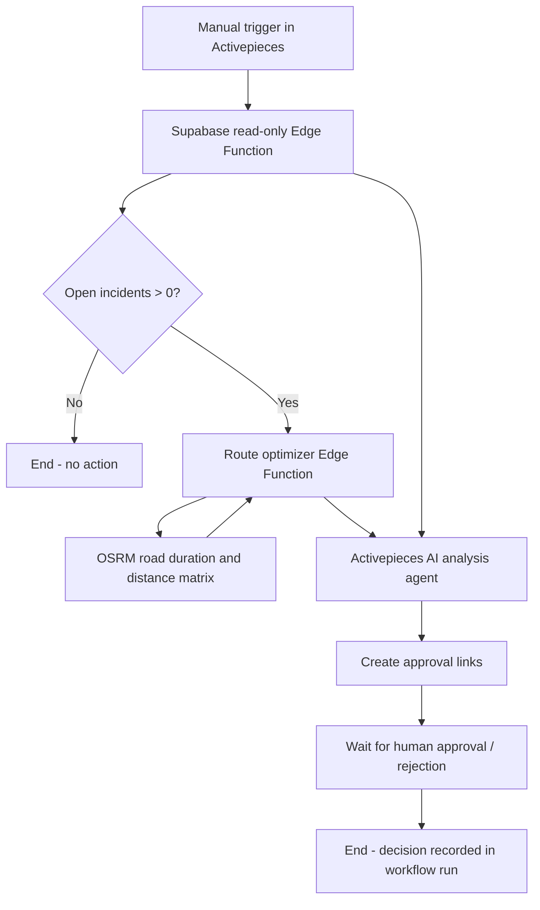

# RouteOps AI

**AI-assisted incident recovery and route optimization, with human-in-the-loop review.**

RouteOps AI is a cloud-based logistics prototype developed to demonstrate practical AI automation, API integration, constrained route planning, and operational safeguards.

A fictional vehicle breakdown in Helsinki triggers an analysis of impacted bookings. A deterministic route planner estimates alternative assignments and an AI agent explains the results and their risks. The flow pauses for a human decision. **It does not automatically modify vehicle assignments.**

> **Status:** Working demo / proof of concept. Uses synthetic data and modeled assumptions. Not production dispatch software.

## Demonstrated scenario

Three vehicles, each with a capacity of eight units, are assigned 15 synthetic pickup bookings. VAN-02 becomes unavailable due to an engine failure, affecting five bookings.

In an observed demo run, the planner returned a candidate reassignment of all five bookings:

| Vehicle | Newly proposed bookings | Total assigned load |
| --- | --- | --- |
| VAN-01 | RO-010, RO-011 | 8 / 8 |
| VAN-03 | RO-007, RO-008, RO-009 | 7 / 8 |

The planner reported a combined **104.5 buffered driving minutes** and no modeled capacity or time-window violations. These are results for this **single sample scenario**, not claims of global optimality or real-world feasibility.

Both approval and rejection paths have been exercised in Activepieces; they record an operator decision in the workflow run, **not in the PostgreSQL proposal tables**. No bookings are modified by either path.

## Architecture



**Responsibilities are deliberately separated:** the AI explains a plan, while code performs constrained calculations and the approval step remains under human control.

## Technology

| Component | Technology | Purpose |
| --- | --- | --- |
| Database | Supabase PostgreSQL | Vehicles, bookings, incidents and draft plan schema |
| Secure API | Supabase Edge Functions / TypeScript | Authenticated read-only access |
| Route optimizer | TypeScript, bounded beam-search insertion | Candidate reassignment and modeled constraints |
| Road routing | OSRM / OpenStreetMap | Estimated driving durations and distances |
| Workflow | Activepieces Cloud | API calls, conditional branching, approval |
| AI analysis | Activepieces AI agent | Incident report, risks and operator recommendations |

The agent is invoked as part of a **workflow**, rather than independently choosing and calling each tool. MCP is a possible future enhancement but is **not implemented in this version**.

## Repository structure

```text
supabase/
  schema/
    01_schema_seed.sql              # PostgreSQL schema and synthetic Helsinki test data
  functions/
    routeops-read/index.ts          # Read-only incident snapshot
    routeops-optimize/index.ts      # Read-only candidate optimizer
docs/
  workflow.md                       # Workflow reconstruction and test evidence
  security.md                       # Threat model and limitations
.gitignore
README.md
```

The currently deployed read function may be named `swift-task` in Supabase. Repository names are normalized for clarity.

## Reproduce the demo

1. Create a **dedicated demo** Supabase project on a free plan. Never load sensitive or real customer data.
2. Execute `supabase/schema/01_schema_seed.sql` in the SQL editor.
3. In **Edge Functions → Secrets**, set a strong, unique `ROUTEOPS_API_TOKEN`. Supabase-managed `SUPABASE_URL` and `SUPABASE_SERVICE_ROLE_KEY` must be available to the functions.
4. Deploy both functions to Supabase. Their entrypoints live under `supabase/functions/`. For this MVP, disable legacy JWT verification **only after validating that the custom token header check is deployed and working**.
5. Manually simulate an outage:
   ```sql
   BEGIN;
   UPDATE public.vehicles SET status = 'unavailable' WHERE code = 'VAN-02';
   INSERT INTO public.incidents (vehicle_id, description)
   SELECT id, 'Engine failure - vehicle cannot continue its route'
   FROM public.vehicles WHERE code = 'VAN-02';
   COMMIT;
   ```
   Run in a clean demo dataset, once per test scenario.
6. Test the read endpoint with `GET /functions/v1/<deployed-read-name>` and the `x-routeops-token` header.
7. Test the optimizer with `POST /functions/v1/routeops-optimize`, `Content-Type: application/json`, the same private token header, and body `{"vehicle_code":"VAN-02"}`.
8. In Activepieces, construct the flow described in [workflow documentation](docs/workflow.md). Store the API token privately; do not include it in exports or screenshots.

The included SQL seed uses relative demo dates (`CURRENT_DATE + 1`). If you already seeded an older database, move its synthetic booking date forward before recording a fresh demo; the seed intentionally does not overwrite existing records.

## Design choices and important limitations

- **No automatic dispatch writes.** Approval is recorded by Activepieces only; approval does not execute any SQL transaction. The two `route_proposal*` tables are reserved for future persistence.
- **Candidate feasibility, not real-world proof.** Assumes an 08:30 vehicle start, a central Helsinki depot, 10 minutes per pickup, and a 20% driving-time buffer. Driver shifts, live traffic, real vehicle positions and customer-specific constraints are not modeled.
- **Heuristic, not exact optimization.** A bounded beam-search insertion method returns a candidate and does not guarantee a globally optimal solution or establish impossibility when no candidate is found.
- **Demonstration scale.** Max 30 bookings per day. Only a single affected date and a simplified pickup model are supported.
- **External dependency.** The public OSRM demo service is appropriate only for small-scale non-commercial experimentation; commercial deployment needs a suitable hosted or self-managed router.
- **Privacy/security.** Supabase service-role credentials exist only server-side. API requests authenticate with a custom shared token. Token rotation, rate limiting, audit logs and test coverage should be strengthened before production use.
- **Validation.** The workflow has been manually tested with an outage scenario and both approval outcomes; there is not yet an automated test suite or CI pipeline.

## Possible extensions

- Persist draft proposals and decision/audit history in transaction-safe APIs.
- Build an MCP server for scoped, callable route-planning tools.
- Add automated tests (capacity, time-window edge cases, unavailable OSRM, zero incidents, denied approval).
- Add a UI showing route maps, approvals and agent traces.
- Replace synthetic assumptions with validated business input and production-grade routing.

## Project note

RouteOps AI is an independent portfolio project using **synthetic** logistics information. No real customer information is included.

**Author:** William Skogberg
